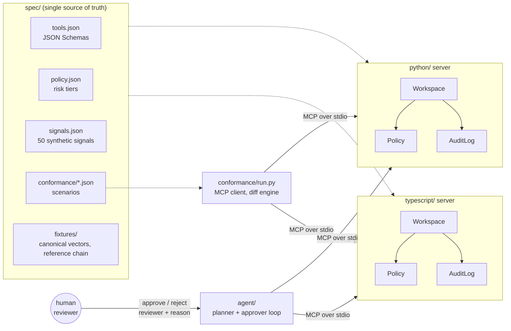

# mcp-hitl

Human-in-the-loop tooling over MCP: twin Python and TypeScript servers expose an evidence workspace (search, assess, propose action). Every consequential action needs human approval, and every step carries confidence scores and lands in an append-only audit trail.


## What it demonstrates

- **One contract, two implementations.** `spec/tools.json` defines every tool's input and output JSON Schema. A Python server and a TypeScript server, each built on the official MCP SDK for its language, implement it independently.
- **A conformance suite that diffs implementations, not just checks them.** `conformance/run.py` acts as an MCP client. It launches each server over stdio and replays 8 scenario files (67 steps). It fails if either server breaks an expectation, drifts from the spec schemas, or returns anything different from the other server, down to audit hashes.
- **Policy as code for approvals.** Each action type has a risk tier (`spec/policy.json`). Low-risk actions auto-approve only above a confidence threshold. Medium and high risk always need a named human. Proposal floors, minimum reason lengths and separation of duties are enforced on both servers.
- **Score and confidence kept apart.** `assess` returns impact ("how bad if true") separately from belief ("how much should we trust it"), plus a factor-by-factor rationale. The policy can then refuse a severe but uncorroborated alarm.
- **Hash-chained audit log.** Every transition, refused ones included, is appended with the SHA-256 of the previous entry. Canonical JSON is specified so precisely that both languages produce byte-identical chains. A verifier pinpoints the first tampered entry.
- **An agent loop that can propose but never decide.** A deterministic planner (or an optional hosted LLM provider) triages signals. The loop pauses in the terminal for a human verdict, with `--auto-reject` and `--approve-all` for CI and demos.

## Architecture



Each server has the same three layers: a thin MCP adapter (`server.py` / `server.ts`), a transport-independent `Workspace` that owns state and transitions, and two leaf modules, `Policy` (interprets `policy.json`) and `AuditLog` (hash chain). The workspace reads the clock exactly once per write operation and has no randomness. Under the fixed clock (`HITL_CLOCK=fixed:...`), a scenario is a pure function of its inputs, so the conformance runner can demand exact agreement between the two servers. The agent and the runner talk to the servers only through MCP, so either one works against any server that implements the spec.

Tools: `search_signals`, `get_signal`, `assess`, `propose_action`, `approve_action`, `reject_action`, `list_actions`, `list_audit`. Resources: `audit://log`, `audit://verify`, `policy://current`. Prompt: `triage`.

## Quickstart

Requires Python 3.12+ and Node 20+.

```bash
# install (Python packages in a venv, TypeScript deps from the lockfile)
python3 -m venv .venv
.venv/bin/pip install -r requirements-dev.txt     # mcp, jsonschema, pytest, ruff, mypy + both local packages
(cd typescript && npm ci && npm run build)         # @modelcontextprotocol/sdk, zod; vitest for tests

# run the agent against either server (non-interactive)
.venv/bin/hitl-agent --server python --auto-reject --fixed-clock 2026-03-02T09:00:00Z
.venv/bin/hitl-agent --server typescript --approve-all

# interactive: you are prompted for each pending action, your reviewer name and a reason
.venv/bin/hitl-agent --server typescript

# the conformance suite against both servers
.venv/bin/python conformance/run.py               # add -v for step names, --case 07_audit for one case

# tests
(cd typescript && npm test)                         # vitest
.venv/bin/python -m pytest -q                       # Python server, agent, conformance wrapper

# verify a persisted audit chain
HITL_AUDIT_PATH=audit.jsonl .venv/bin/hitl-agent --server python --auto-reject
.venv/bin/hitl-audit audit.jsonl
```

`make ci` runs the same sequence as `.github/workflows/ci.yml`. Abridged output of the first agent command:

```text
[ASM-0002] site HUB-ISEN: SIG-013
    score 0.84  confidence 0.475  band critical
    - Sources: 1 distinct (manual_report), mean reliability 35/100
    - Low source reliability: treat as unverified
    proposed ACT-0003 notify_team          pending_approval (low risk but confidence 0.475 < 0.75: human approval required)
    denied   hold_shipment        high risk requires confidence >= 0.5 to propose, assessment has 0.475
    proposed ACT-0004 increase_monitoring  pending_approval (low risk but confidence 0.475 < 0.75: human approval required)
...
  24  action.rejected        ci.reviewer      ACT-0002   f4587c64.. 144ef6de..
chain VALID, 30 entries, head 49dba436e967be6e..
actions: 4 approved, 7 rejected; denied by policy at proposal time: 1
```

Both servers print the same head hash for this run.

## Design decisions

1. **Two implementations behind one conformance suite.**
   *Decision:* write the server twice and treat `spec/` as the product, with a runner that compares implementations step by step.
   *Why:* a protocol contract is only as precise as its weakest reading. A second independent implementation exposes every place where the spec was silent: integral floats serialized differently (`1.0` against `1`), half-even against half-up rounding, lax type coercion on one side and strict validation on the other, error wording. Each of these became an explicit rule in the spec, a shared fixture, or a normalization in the runner. Cross-implementation diffing also catches bugs that a single implementation's tests share with their author.
   *Trade-off:* every change has to land twice. The runner turns that cost into a check rather than a hope, but the cost is real. For a single-language team, the same suite would still pay off as a contract test for third-party clients.

2. **Policy as code, evaluated at two points.**
   *Decision:* risk tiers and thresholds live in `policy.json`. The policy runs at proposal time (may this be proposed, and may it skip the human?) and again at decision time (is this reviewer allowed, is the reason substantive, is the proposer approving their own action?).
   *Why:* approval rules change more often than code and need review by people who do not read code. Keeping them as data means a threshold change is a one-line diff, both servers pick it up, and the conformance suite pins the current values. Refused proposals and refused decisions are audited too: "the agent tried to approve its own action and was stopped" is evidence an auditor wants.
   *Trade-off:* a JSON policy only expresses what the interpreter understands. Conditions such as "high risk at a site with an open incident" would need a richer rule language or a decision-table standard, and then a conformance suite for the policy engine itself.

3. **Hash-chained, append-only audit with cross-language canonical JSON.**
   *Decision:* each entry stores the previous entry's SHA-256, and its own hash covers every other field, serialized as canonical JSON (sorted keys, no whitespace, ECMAScript number layout).
   *Why:* editing, deleting, reordering or relinking an entry breaks every later hash, and `verify` names the first bad sequence number. Making the encoding identical across languages lets a chain written by one implementation be verified by the other, and lets the conformance suite assert equal head hashes. `spec/fixtures/canonical_vectors.json` and a reference chain pin the encoding.
   *Trade-off:* a hash chain proves internal consistency, not completeness. Someone with write access can truncate the tail or rewrite the whole file and re-hash it. Production use needs the head hash anchored outside the system (periodic signed checkpoints, or publication to an independent write-once store).

4. **Confidence is a heuristic and is labelled as one.**
   *Decision:* confidence combines mean source reliability, source diversity and the coherence of the signal group, capped at 0.6 when only one source type is present. It is rounded to four decimals with the same IEEE operations in both languages.
   *Why:* the policy needs a number to gate auto-approval, and a transparent formula with a rationale beats an opaque one. The single-source cap encodes a rule analysts already apply: one feed, however reliable, is not corroboration.
   *Trade-off:* this is not a calibrated probability, and the tool description says so. A 0.75 threshold means nothing until it is checked against outcomes. The honest path is to log decisions and eventual ground truth, plot reliability curves per action type, fit a calibration map (isotonic or Platt), and only then set thresholds. Until then, auto-approval is limited to actions whose worst case is a redundant notification.

5. **Strict validation and a deterministic clock as part of the contract.**
   *Decision:* the Python server validates arguments against the advertised JSON Schema before dispatch, turning off the SDK's lax coercion. Both servers accept `HITL_CLOCK=fixed:<ISO>` and read it once per operation.
   *Why:* if one server accepts `"limit": "5"` and the other rejects it, clients written against one break on the other. Making both strict is the only behaviour worth specifying. The fixed clock makes timestamps, and therefore audit hashes, comparable, which turns "both servers seem to work" into "both servers produce the same bytes".
   *Trade-off:* strict validation rejects some inputs a forgiving server would accept (for example, models that send numbers as strings). That is deliberate here. A public server might add an explicit, specified coercion layer instead.

6. **The planner proposes, only a human decides.**
   *Decision:* the agent loop calls `approve_action` and `reject_action` only with a verdict from an `Approver`. Automated identities (`agent:*`, `policy:*`) cannot sign decisions, and the proposer cannot approve their own medium or high risk action.
   *Why:* swapping the deterministic planner for an optional hosted LLM provider changes what gets proposed, never who approves it. The LLM planner's output is parsed defensively: anything outside the allowed action set, including an attempt to name an approval tool, falls back to the deterministic plan.
   *Trade-off:* a human queue adds latency to every non-trivial action, and reviewers can rubber-stamp. The minimum reason length and the audit trail make rubber-stamping visible, but they do not prevent it.

## Scope and limits

- State is in memory per server process. `HITL_AUDIT_PATH` persists the audit chain (and refuses to extend a broken one), but assessments and actions are not reloaded on restart.
- Reviewer identity is a string supplied by the client. In production it must come from an authenticated principal, with the transport carrying that identity (HTTP transport with auth). Only stdio is implemented.
- Single-writer by design: no concurrency control, no multi-tenant isolation.
- The audit chain detects tampering but is not externally anchored (see decision 3).
- Search is weighted keyword matching over 50 signals. Retrieval quality is not the point of this lab.
- The hosted LLM planner is optional and exercised in tests only through its fallback paths. No test or CI step makes a network call.
- Canonical JSON relies on both runtimes ordering keys the same way, which holds for every key outside the astral Unicode planes. All keys this system emits are ASCII.
- The dataset is entirely synthetic: sites, suppliers, carriers and events are invented.

## About this lab

A compact reference implementation written in 2026. It reconstructs, on synthetic data, patterns I have used in production systems (human approval gates for AI-proposed actions, evidence scoring with explicit confidence, tamper-evident audit trails, and contract-first services with more than one implementation), without reproducing any proprietary design.

## License

MIT, see [LICENSE](LICENSE).
